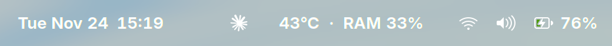
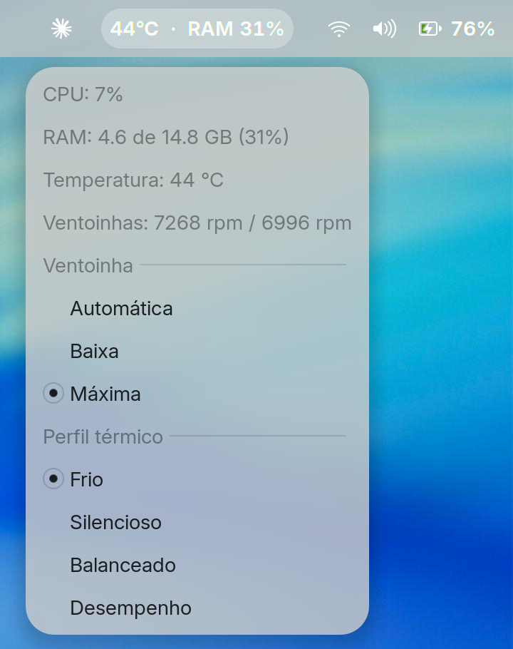

# Dell Fan Monitor

A small GNOME Shell extension for Dell laptops. It shows CPU temperature and
RAM usage in the top bar, and its menu lets you change the fan speed and the
thermal profile with one click.

[Português (Brasil)](README.pt-BR.md)





The screenshots show the Portuguese translation.

## What it does

- **Top bar:** CPU temperature and RAM usage, refreshed every 3 seconds.
- **Menu:** CPU usage, RAM in GB, temperature and the speed of each fan.
- **Fan:** Automatic, Low or Maximum.
- **Thermal profile:** the profiles your laptop offers, such as Cool, Quiet,
  Balanced and Performance.

It has no dependencies beyond GNOME Shell itself. Everything is read from
`/proc` and `/sys`.

## Requirements

- GNOME Shell 50. It was written for the GNOME 45+ extension API, but 50 is
  the only version it has been tested on.
- A Dell laptop where the kernel's `dell_smm_hwmon` driver exposes fan
  control (`pwm1` and `pwm1_enable`). Check with:

  ```sh
  grep -l dell_smm /sys/class/hwmon/hwmon*/name
  ```

- Thermal profiles need `/sys/firmware/acpi/platform_profile`.
- `polkit` (`pkexec`), which GNOME already depends on.

Tested on one machine: a Dell XPS 13 7390 running Ubuntu 26.04. On other
hardware the monitor part works anywhere `coretemp` exists, and the fan and
profile sections hide themselves when the hardware does not support them.

## Install

```sh
git clone https://github.com/protonnegativo/dell-fan-monitor.git
cd dell-fan-monitor
make install
sudo make install-helper
```

Then log out and back in, and enable it:

```sh
gnome-extensions enable dell-fan-monitor@protonnegativo.github.io
```

The Portuguese translation is built only if `gettext` (`msgfmt`) is
installed. Without it the extension is installed in English.

### What the helper is

Changing fan speed means writing to files only root can write. So
`sudo make install-helper` installs three things:

- `/usr/local/sbin/dell-fan-monitor-helper`: a short shell script that
  accepts only `fan auto|low|high`, `profile <name>` and `restore`. It writes
  to the fan and thermal-profile files in `/sys` and saves the chosen fan
  mode in `/var/lib/dell-fan-monitor/mode`. Read it before installing:
  [helper/dell-fan-monitor-helper](helper/dell-fan-monitor-helper).
- `dell-fan-monitor-restore.service`: a systemd unit that runs
  `dell-fan-monitor-helper restore` at boot and after every resume from
  suspend, so the fan mode you chose is applied again.
- A polkit rule that lets the logged-in local user run that one script
  without typing a password. Remote and inactive sessions still need admin
  authentication.

Without the helper the extension still works as a monitor.

## Safety

- **Low** and **Maximum** switch the fans to manual control, so the firmware
  stops adjusting them. If the CPU reaches 88 °C while the fan is on Low, the
  extension hands control back to the firmware and shows a notification.
  This check runs inside the extension, so it only works while you are
  logged in with the extension enabled.
- There is no option to turn the fans off.
- After a suspend the fan controller can stay in manual mode with the fans
  stopped. The restore service re-applies your mode a few seconds after
  resume, and the extension does the same if it reads 0 rpm twice in a row.
- This software comes with no warranty. Use manual fan control at your own
  risk.

## Uninstall

```sh
make uninstall
sudo make uninstall-helper
```

## License

GPL-3.0-or-later. See [LICENSE](LICENSE).
